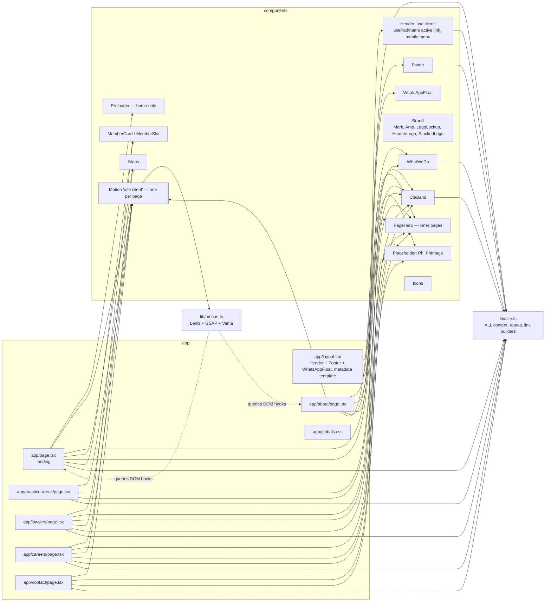

# Context graph — Rajaul & Lawyers website (`law-firm`)

Map of the repo (branch `main`, remote `github.com/hamxa17/law-firm`). Base commit `a553d5a`; updated 2026-11-14 when the in-page sections became separate pages.
Use this file instead of re-reading the whole folder. **Update it in the same change whenever files, routes, sections, content or motion hooks change.**

## 1. What this is

- A multi-page marketing site for **Rajaul & Lawyers** (Advocates & Tax Consultants, Kakrail, Dhaka).
- **Routes** (all statically prerendered): `/`, `/about`, `/practice-areas`, `/lawyers`, `/careers`, `/contact`.
- **Stack**:
  - Next.js 15.5 (App Router), React 19.3 and TypeScript, with **plain CSS** (no Tailwind).
  - GSAP 3.15 (ScrollTrigger, SplitText) and Lenis 1.3 for motion.
  - Vanta fog on three 0.134 for the WebGL background.
  - Fonts are self-hosted through `@fontsource` (Bodoni Moda, Cormorant Garamond, Inter).
- **Scripts**: `dev`, `build`, `start`. There's no lint script or ESLint config (`next build` still runs its type check).
- **Brand**: navy, royal and champagne (see §6).

## 2. File graph

| File | Role / key facts |
|---|---|
| `app/layout.tsx` | Renders `Header`, `{children}`, `Footer` and `WhatsAppFloat`. Metadata `title.template = "%s · Rajaul & Lawyers"`. Icon is `/brand/mark.png`. |
| `app/page.tsx` | Landing: Preloader, Motion, then Hero → marquee → `WhatWeDo id="about"` → Why → Areas `#practice` → Stats → How (`Steps`) → Team `#team` (4 `MemberCard`s) → `CtaBand id="contact"`. Its links now go to the routes. |
| `app/about/page.tsx` | PageHero (with fact list: Established = placeholder) → Vision & Mission → `WhatWeDo` → "Our Standards" (`values`) → Our Story (placeholder history and image) → Founder feature (placeholder bio) → `CtaBand`. |
| `app/practice-areas/page.tsx` | PageHero → cream **index** of all 15 (links `#slug`) → one `article.practice#slug` per area: number, title, summary (or placeholder), placeholder description and services, a "Discuss a matter" WhatsApp link with prefilled text → `CtaBand`. |
| `app/lawyers/page.tsx` | PageHero → Founder feature → team grid: the 3 other known members, plus `TEAM_SIZE − team.length` (= 7) `MemberSlot` placeholders → `CtaBand`. |
| `app/careers/page.tsx` | PageHero (placeholder intro) → "Life at the firm" (`careerPerks`, all placeholders) → Openings (`openings` is empty, so it shows an empty state with Email CV / WhatsApp) → "How we hire" (`Steps` with `hiringSteps`, 4 items) → `CtaBand` with custom copy. |
| `app/contact/page.tsx` | PageHero → 5 contact cards (Visit / Call / WhatsApp / Email / Office hours = placeholder) → Find us (map placeholder plus a Google Maps link) → Direct lines (founder, plus a placeholder row). **No CtaBand**, so Vanta doesn't run here. |
| `components/Header.tsx` | `is-scrolled` after 40px; `is-active` and `aria-current` come from `usePathname`; next/link everywhere. |
| `components/Footer.tsx` | Extracted from the old page; route links; practice links go to `/practice-areas#slug`. |
| `components/PageHero.tsx` | Props `crumb`, `eyebrow`, `title: string[]`, `intro?`, `aside?`. The title has `data-split`; the intro has `data-reveal`. |
| `components/CtaBand.tsx` | Props `eyebrow`, `title[]`, `text`, `showContactLink`, `id`. Contains `.cta__vanta`. |
| `components/Placeholder.tsx` | `<Ph value>` renders `ph(...)` values as a dashed `.ph-text` note; `<PhImage label ratio initials tone>` is a hatched image stand-in. |
| `components/Steps.tsx` | `<ol class="steps" style="--steps:N">`; the column count follows N. |
| `components/MemberCard.tsx` | `MemberCard` (monogram portrait) and `MemberSlot` (placeholder slot). |
| `components/WhatWeDo.tsx`, `WhatsAppFloat.tsx`, `Brand.tsx`, `Icons.tsx`, `Preloader.tsx`, `Motion.tsx` | As named. `HeaderLogo` uses next/link. |
| `lib/site.ts` | **Single source of content** (§5). |
| `lib/motion.ts` | **All animation** (§4). |
| `public/brand/mark.png` | The only brand asset: the monogram, used as a CSS mask. |

## 3. Navigation & links

- **Nav** (`navLeft` / `navRight` in `lib/site.ts`, built from the `routes` constant): Home `/` · About Us `/about` · Practice Areas `/practice-areas` | Lawyers `/lawyers` · Careers `/careers` · Contact Us `/contact`.
- **Landing → pages**:
  - "Our Practice" → `/practice-areas`
  - "About the Firm" → `/about`
  - Area cards → `/practice-areas#<slug>`
  - "All 15 Areas" → `/practice-areas`
  - "Meet All 11" → `/lawyers`
  - CTA "Contact Us" → `/contact`
- **In-page anchors on the landing page**: `#about` (What we do), `#practice`, `#team`, `#contact`. The hero "Scroll" button links to `#about`.
- **Link builders** (never hand-write these URLs):
  - `waLink(message?)`: wa.me with prefilled text.
  - `mailLink(subject?)`
  - `areaHref(slug)`
  - `areaNumber(slug)`

## 4. Motion (`lib/motion.ts`) ↔ markup hooks

`<Motion />` is rendered **inside each page**, so `initMotion()` runs on every navigation. The cleanup reverts the GSAP context, destroys Lenis and removes `header.is-hidden`. Header, footer and the WhatsApp button live in the layout and persist between pages. Every step is guarded, so missing elements are skipped.

| Hook | Behaviour |
|---|---|
| `.preloader*` (home only) | 1. Logo flies into the header (FLIP); Lenis stays locked until it finishes. |
| `.hero` present → hero timeline; absent → page intro | 2. Home: title, word chars, image curtain and parallax. Inner pages: start Lenis, fade in `.nav li`, `.page-hero .crumbs/.eyebrow` and `.wa-float`. |
| `.site-header` → `.is-hidden` | 3. Hides on scroll down past 420px and returns on scroll up. |
| `.marquee__track` | 4. Velocity-driven marquee (home only). |
| `[data-split]` | 5. Line-mask reveal; this is how inner-page titles animate. |
| `[data-blur]` | 6. Word blur-in (quote). |
| `[data-reveal]` | 7. Batched fade-up. |
| `.reveal-img`, `[data-parallax]` | 8. Curtain and parallax. |
| `[data-count]`, `.stat__star` | 9. Count-up (home). |
| each `.steps` (`.steps__line`, `.steps__icon`) | 10. Line draw and icon pop, per list. |
| `.footer__word` | 11. Wordmark chars rise. |
| `[data-magnetic]` | 12. Magnetic hover. |
| `.cta__vanta` | 13. Vanta fog while `.cta` is near view. |
| `a[href^="#"]` | Lenis `scrollTo` with offset −96. Cross-page hash links rely on Next scroll and `.practice { scroll-margin-top: 96px }`. |

Under reduced motion the preloader is removed and nothing animates. **Renaming a hook class or attribute silently breaks its animation.**

## 5. Content model (`lib/site.ts`)

| Export | What it holds |
|---|---|
| `ph(text)` / `isPh` / `Placeholder` | Placeholder marker for copy waiting on the client. Every pending item is grep-able as `ph(` here and `ph-text` in JSX. |
| `images` | 8 Unsplash URLs. |
| `routes`, `navLeft`, `navRight` | Routes and nav. |
| `contact` | Phone, `phoneHref`, `whatsapp` base, email, `addressLines`, `map`, `hours` (placeholder). |
| `firm` | Name, descriptor, tagline, intro, vision, mission, quote, reputation, `founded` (placeholder), `history` (placeholder). |
| `values` | 3 "standards" for About. |
| `practiceAreas: PracticeArea[]` | 15 × `{slug, title, summary?, featured?}`; 6 are featured with summaries. `featuredAreas` is derived from them (with `n`, `body`). |
| `competencies` | 3. |
| `steps` | Home process, 5 steps. |
| `TEAM_SIZE = 11`, `team: Member[]` | Only 4 members are listed (`founder` flag on Md. Rajaul Islam); `founderBio` is a placeholder. |
| `stats` | Derived from the counts above, except "06 Advocates at the Bar", which is hard-coded. |
| `openings` | Empty list. |
| `careerPerks` | Placeholders. |
| `hiringSteps` | 4 steps. |

Contact facts: +880 1917-506510 (also WhatsApp) · advrajaul@outlook.com · Green City Regency, 2nd Floor, 26-27 Kakrail, Dhaka-1000.

## 6. Design tokens & CSS map (`app/globals.css`)

**Tokens** (`:root`):

| Token | Value |
|---|---|
| `--navy` | `#05253f` |
| `--navy-deep` | `#031a2e` |
| `--royal` / `--royal-hi` | `#0b3760` / `#12497d` |
| `--steel` | `#375e7d` |
| `--ink` | `#060c14` |
| `--cream` / `--paper` | `#f3eee6` / `#f5efe6` |
| `--champagne` | `#f0dab8` |
| `--f-display` / `--f-serif` / `--f-sans` | Bodoni Moda / Cormorant Garamond / Inter |
| `--pad` | `clamp(20px, 3.2vw, 40px)` |

**CSS map, in file order**:
1. type primitives (`.eyebrow`, `.display`, `.label`, `.body`, `.numeral`)
2. buttons (`.btn--solid`, `--ghost`, `--outline-dark`)
3. logo, header, hero, marquee
4. sections (`.section--cream` / `--ink`)
5. landing blocks (what, why, areas, stats, how, team, cta, footer, wa-float)
6. **INNER PAGES** block:
   - `.ph-text`, `.ph-img`, `.page-hero`, `.crumbs`, `.fact-list`
   - `.split`, `.prose`, `.value-grid`, `.feature*`
   - `.index-list`, `.practice*`, `.team-grid`, `.member--slot`
   - `.openings`, `.empty-state`, `.contact-grid`, `.contact-card`, `.directory`
   - its own 1100 / 860 media queries
7. responsive (1100px, 860px)
8. MOTION states (`.motion-ready`, preloader, curtains, button sweep, Vanta)

## 7. Known gaps

- **Layout bugs (shared header and footer, so they appear on every page)**:
  - **375px**: the page is about 445px wide; the header lockup doesn't shrink and the Menu button sits off-screen, so phone navigation can't be opened.
  - **768px**: the page is about 895px wide; the footer wordmark chars (plus the landing hero and CTA images) overflow.
  - **Desktop**: the floating WhatsApp button covers the footer credit.
  - The new page content itself adds no overflow (checked at 1440, 768 and 375).
- **Content placeholders** (grep `ph(` and `ph-text`):
  - year founded, firm history, founder bio
  - 11 practice-area summaries and all 15 descriptions and service lists
  - 7 team members, all portraits
  - careers intro and perks
  - office hours, map pin and directions, other lawyers' direct lines
- **Media**:
  - Unsplash stand-ins as raw ``.
  - Only the monogram mask exists; there are no full logo files.
  - The favicon is the mask PNG.
- **Missing**:
  - custom 404, sitemap, robots, OG image
  - lint setup
  - the "06 Advocates at the Bar" stat isn't derived from data
